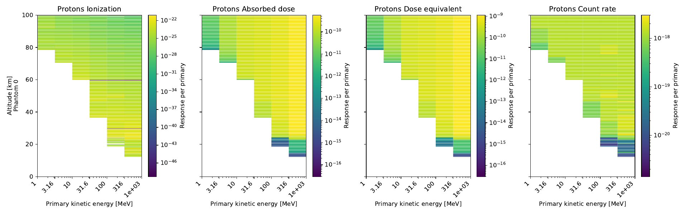
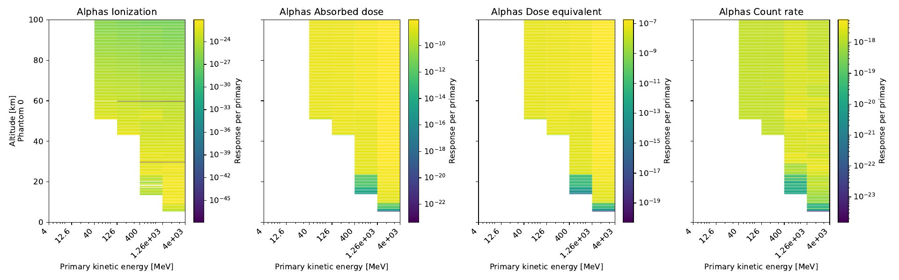

# AtRIS

AtRIS (Atmospheric Radiation Interaction Simulator) is a Geant4-based
particle-transport code for parametric studies of radiation propagation through
planetary and exoplanetary atmospheres. Its flexible description of the
atmosphere and regolith supports studies of altitude-dependent secondary
particles and ion-pair production for atmospheric chemistry and habitability
research.

AtRIS also calculates atmospheric ionization, absorbed dose, dose equivalent,
and count rate. It was developed by Saša Banjac and validated against Earth
measurements, as described by
[Banjac, Herbst, and Heber (2018)](https://doi.org/10.1029/2018JA026042). This
repository provides the simulator, preparation and post-processing tools, and
phantom response files; the workflow below focuses on multithreaded Earth
atmosphere simulations.

This guide explains how to prepare, run, and inspect an AtRIS simulation. See
[INSTALL.md](INSTALL.md) for installation and build instructions, and
[docs/hpc.md](docs/hpc.md) for architecture and sizing guidance for larger
scatter/gather simulations on an HPC system.

A small set of prepared inputs is included in the
[reduced Earth atmosphere example](examples/earth-nrlmsis-reduced/README.md).
The [full Earth atmosphere example](examples/earth-nrlmsis-full/README.md) uses
a 0.2 km atmosphere grid and the default particle settings.

## Start a shell session

These instructions use the [directory layout](INSTALL.md#directory-layout)
from `INSTALL.md`.
```bash
cd <ATRIS_WORK>
```
Prepare the current shell to run AtRIS with Geant4:
```bash
source atris/setup_atris.sh
```

If you wish you can source this script from your rc file.

The `atris-*` workflow commands normally log a short progress summary. Pass
`--quiet` to show only warnings and errors, or `--verbose` to include detailed
progress such as individual files and chunks.

## Prepare the example run

Keep each simulation's inputs and outputs in a separate directory. Copy the
prepared reduced Earth example into `runs/my-first-run`:

```bash
mkdir -p runs
cp -R "$ATRIS_ROOT/examples/earth-nrlmsis-reduced" runs/my-first-run
cd runs/my-first-run
```

Stage the two selected phantom response pairs under the numbered filenames
expected by AtRIS:

```bash
atris-stage-phantoms .
```

The copied directory contains the fixed atmosphere and geometry, proton and
alpha inputs, and phantom selection. Its local `README.md` explains how those
inputs were prepared.

## Run AtRIS

Use four Geant4 worker threads and run the proton and alpha simulations in the
run directory:

```bash
export G4FORCENUMBEROFTHREADS=4
AtRIS FTFP_BERT_HP protons -1 2
AtRIS FTFP_BERT_HP alphas -1 2
```

The four AtRIS arguments are:

```text
FTFP_BERT_HP   Geant4 physics list
protons/alphas prefix for the .gdml, .mac, .bins, and output files
-1             histogram/CSV output mode used by this workflow
2              number of numbered phantom pairs to load
```

Mode `-1` (`response`) writes the standard histogram output. Mode `0`
(`profile`) adds particle records at layer interfaces in `<name>.binary`. Mode
`1` (`shower`) writes the same interface file and adds one transport-step record
per step in `<name>.steps.binary`; this can produce much more data than the
other modes.

Inspect either binary format as a CSV stream with `atris-dump`:

```bash
atris-dump protons.binary | head
atris-dump protons.steps.binary | head
```

`head` closes the pipe after its requested number of lines. The dumper then
stops reading; neither command modifies the binary file.

Without `G4FORCENUMBEROFTHREADS`, AtRIS uses all processors detected by Geant4.

An existing macro containing `/run/numberOfThreads` retains that setting unless
`G4FORCENUMBEROFTHREADS` is set.

Starting a simulation is reported by:

```text
### AtRIS: Starting the simulation
```

A completed simulation later reports:

```text
### AtRIS: the simulation has completed
### AtRIS: The logfile has been sucessfully closed...
```

The run directory then contains CSV output files beginning with `protons_` and
`alphas_`.

### Scatter and gather a larger run

Scatter/gather is suitable for larger simulations whose work should be divided
into independent, restartable chunks. From a prepared run directory, create 20
proton and 20 alpha chunks:

```bash
atris-scatter --chunks 20 --random-seed 12345
```

This creates seed-free `protons.chunk.mac` and `alphas.chunk.mac` variants, an
empty `chunks/` output directory, and `chunks.txt`. The ordinary macros are not
changed and remain available for single runs. Each line of `chunks.txt` gives a
particle species and two random seeds. Initial `--chunks` creation will not
overwrite an existing plan, chunk macro, or nonempty `chunks/` directory.

The `/run/beamOn` total from each ordinary macro is divided among its chunks.
All chunks share one macro, so the per-chunk count is rounded up when the total
does not divide evenly. In that case `atris-scatter` reports both the requested
and actual totals; the actual total exceeds the request by fewer than the number
of chunks.

The chunks can be executed independently. Each successful repetition writes
its outputs beneath `chunks/` and adds a `COMPLETE` marker. Incomplete chunks
can be run again without repeating completed work.

For worker-pool architecture, sizing, chunk safety, and recovery guidance, see
[Running AtRIS on an HPC system](docs/hpc.md). For a copy/paste workflow, use
the [full Earth Slurm example](examples/earth-nrlmsis-full-slurm/README.md),
which provides concrete five-node simulation and gather scripts.

Run the incomplete chunks sequentially in the current shell:

```bash
atris-run
```

Completed chunk outputs begin appearing beneath `chunks/` while the command is
still running. Raw AtRIS output is written to one log file per chunk. If the
command is interrupted, running it again skips chunks already marked
`COMPLETE`.

Gather whichever chunks have completed so far into ordinary proton and alpha
CSV outputs in the run directory:

```bash
atris-gather
```

Running `atris-gather` again replaces those files with a new aggregate of all
chunks complete at that time. It also reports the completed chunk count and,
after two chunks have completed, the average completion interval and a rough
time remaining based on recent `COMPLETE` marker timestamps. For each species
with at least two completed chunks, it also reports how much the final group of
chunks changed the normalized ionization result. This group is 10% of the
completed chunks, rounded up to at least one whole chunk; the output reports
the resulting percentage. The comparison uses chunk-plan order.

The gather also writes `protons.convergence.csv` and
`alphas.convergence.csv` when enough chunks of each species are available.
Each new completed chunk adds a row. The tables track whole-panel ionization
change, the median and 90th percentile changes among populated ionization
cells, and corresponding relative standard-error percentiles estimated from
the independent chunks.

### Add samples when a run has not converged

After stopping all workers, append another independent batch without changing
or repeating any completed chunks:

```bash
atris-scatter --extend 20
atris-run
atris-gather
atris-postprocess
atris-plot
```

`--extend 20` adds 20 proton and 20 alpha entries using the existing per-chunk
event counts. It reports the added and cumulative events for each species. All
existing plan entries, outputs, and `COMPLETE` markers remain unchanged, so
`atris-run` processes only the new entries and the next gather incorporates
them into the convergence history.

The random seed pairs actually passed to AtRIS are stored in `chunks.txt`.
`--random-seed` is optional during extension; provide it only when reproducible
generation of the additional pairs is required. New pairs are checked against
the entire existing plan. Do not extend a plan while a worker allocation or
gather operation is active.

## Inspect the results

Post-process the proton and alpha CSV files in the run directory:

```bash
postprocess
```

This writes the scaled numerical ionization, absorbed-dose, dose-equivalent,
and count-rate files. Create quick-look PNG plots of the run inputs and those
processed files separately:

```bash
atris-plot
```

The input plots can also be created before running AtRIS. Each configured
species gets an image such as `protons.inputs.png`, showing its primary-energy
configuration, atmospheric profiles, composition, and source settings. Each
staged phantom gets an input image showing its radiation and counting response
tables.

After post-processing, each available species also gets a result image such as
`protons.png`, containing primary-energy, source-direction, source-position,
and ionization panels. Each phantom gets its own result image, such as
`protons.icru_zero_0.000MeV_detAB.png`, containing absorbed-dose,
dose-equivalent, and count-rate panels. When convergence tables are present,
`atris-plot` also writes `protons.convergence.png` and
`alphas.convergence.png`. Each convergence image shows ionization change above
the estimated Monte Carlo uncertainty. The upper panel's dashed colour-matched
guides show the inverse-square-root change expected for ordinary Monte Carlo
convergence. The lower panel's dashed curves fit the observed uncertainty with
power laws fitted to the most recent half of the completed chunks and
extrapolated through the planned run. Both axes are logarithmic so their slopes
can be compared directly.

When a mode-1 binary step trace is present, `atris-plot` writes two images. An image
such as `protons.steps.png` summarizes particle species, step-defining
processes, shower development by atmospheric layer, and the kinetic-energy
distribution through the atmosphere. `protons.shower.png` shows the event
containing the most recorded steps in altitude and transverse radius, using
linear axes. The altitude range is limited to the interaction region.

The previews below come from the reduced test configuration in this guide and
are not scientific production results.

**Protons**



**Alphas**


