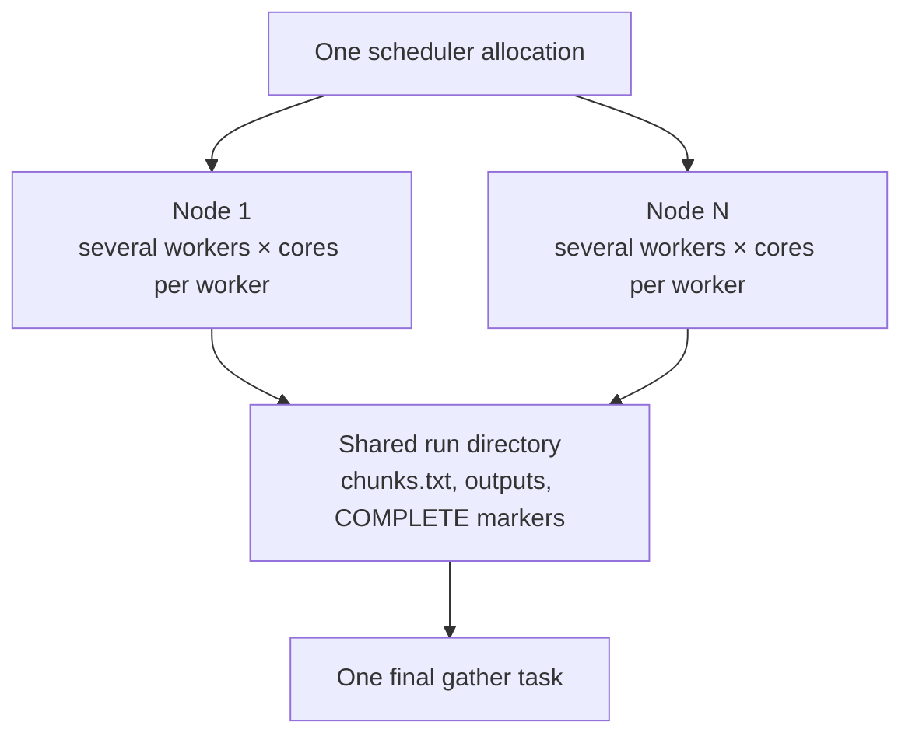

# Running AtRIS on an HPC system

This guide explains the execution model, sizing decisions, and recovery
semantics for running AtRIS on a cluster. It is intentionally advisory rather
than a site-ready submission recipe. The worker model is scheduler-neutral;
Slurm names are used where a concrete scheduler concept helps.

For an executable worked example, use
[`examples/earth-nrlmsis-full-slurm`](../examples/earth-nrlmsis-full-slurm/README.md).
That example supplies the exact preparation commands, five-node `sbatch`
script, monitoring commands, retry procedure, and final gather job. Adapt its
account, partition, QoS, memory, and resource requests to the target site.

## Recommended execution model

Use one scheduler allocation as a pool of persistent chunk workers. Each
worker receives a fixed set of cores and runs several chunks sequentially.
Completed chunks remain available if the allocation ends, and a later
allocation skips them.



This is one allocation containing several long-lived workers, not one
scheduler job per chunk. A worker runs one multithreaded AtRIS process at a
time, then continues with another assigned chunk. This avoids per-chunk queue
latency while retaining restartable chunk boundaries.

Keep the workflow in three distinct phases:

1. Prepare inputs and create `chunks.txt` once.
2. Run one worker-pool allocation at a time until every entry is complete.
3. Gather and post-process with a single writer after completion is verified.

All workers and the gather task must see the same run directory. Do not overlap
two worker pools or run a final gather against the same directory while chunks
are still being written.

## Size the allocation

For equal compute nodes, define:

| Symbol | Meaning |
| --- | --- |
| `N` | allocated nodes |
| `P` | allocatable physical CPU cores per node |
| `Wn` | AtRIS workers per node |
| `C` | CPU cores and Geant4 threads per worker |
| `W` | total workers |

The basic CPU constraints are:

```text
W = N × Wn
Wn × C <= P
```

In Slurm, these map to `--nodes=N`, `--ntasks=W`,
`--ntasks-per-node=Wn`, and `--cpus-per-task=C`. The allocation wall time is
the lifetime of the pool, not the expected duration of one chunk.

CPU arithmetic is only the first constraint. Ensure that
`Wn × measured peak worker memory` fits within usable node memory with margin.
Also account for per-node temporary storage, shared-filesystem bandwidth, and
licence or partition limits. If Slurm exposes hardware threads as CPUs,
benchmark with physical-core placement such as `--hint=nomultithread`.

Choose `C` by measuring completed chunks per node-hour, not merely the runtime
of one chunk. Several medium-sized AtRIS workers can provide better node
throughput than one process using every core, even when the all-core process
finishes an individual chunk sooner.

The [full Earth Slurm example](../examples/earth-nrlmsis-full-slurm/README.md)
instantiates this model as five 80-core nodes, four workers per node, and 20
cores per worker. Those values demonstrate the mapping; they are not universal
recommendations.

## What the wrapper does

[`examples/run-atris.slurm.sh`](../examples/run-atris.slurm.sh) performs the
worker-pool mechanics listed below. It is a reusable implementation component,
not the resource policy for a particular cluster. The
[full Earth Slurm simulation script](../examples/earth-nrlmsis-full-slurm/run-atris.slurm.sh)
provides a concrete resource policy and delegates execution to this wrapper.

The wrapper:

1. Changes to the directory from which `sbatch` was invoked.
2. Sets `G4FORCENUMBEROFTHREADS` to `SLURM_CPUS_PER_TASK`.
3. Launches `SLURM_NTASKS` workers through one core-bound `srun` step.
4. Translates each task's Slurm rank, task count, and deadline into the generic
   `atris-run` worker arguments.
5. Lets each worker run its assigned chunks sequentially and stop before the
   supplied deadline.
6. Checks the complete plan after all workers exit.

`atris-run` does not import a Slurm API or read scheduler environment
variables. The Slurm wrapper supplies its `--worker-index`, `--worker-count`,
`--deadline`, and `--stop-before-end` values explicitly. Other schedulers can
supply the same interface.

Worker rank `r` out of `W` workers receives these one-based `chunks.txt`
entries:

```text
r + 1, r + 1 + W, r + 1 + 2W, ...
```

With 20 workers, worker 0 receives entries 1, 21, 41, and so on; worker 1
receives 2, 22, 42, and so on. This static round-robin assignment is
collision-free and distributes the contiguous proton and alpha sections across
the workers without a shared queue lock.

The `srun` step uses `--kill-on-bad-exit=0`. If one worker fails, the other
workers are allowed to finish instead of immediately losing all their active
chunks. The overall job still reports the failure and can be resubmitted.

Slurm documents these task, binding, and deadline variables in the
[`srun` manual](https://slurm.schedmd.com/srun.html) and
[CPU management guide](https://slurm.schedmd.com/cpu_management.html).

## Choose a practical chunk size

There is no checkpoint inside an AtRIS chunk. If a worker is killed during a
chunk, that chunk restarts from the beginning. Previously completed chunks stay
safe.

Use a short pilot to measure typical and slow-tail chunk times. Then choose:

- a chunk runtime much shorter than the allocation wall time, so every worker
  normally completes many chunks;
- `ATRIS_STOP_BEFORE_END` longer than a slow chunk plus output-flush margin;
- enough events per chunk to amortize AtRIS startup and fixed histogram I/O.

For example, chunks lasting tens of minutes fit naturally inside a multi-hour
allocation. A 15-minute safety window is only the wrapper default; increase it
when measured chunks can take longer.

Benchmark several `--cpus-per-task` values, such as 1, 2, 4, 8, 16, and 20.
Optimize completed chunks per node-hour rather than the duration of one chunk.
Four 20-core workers may produce more results per hour than one 80-core worker
even if the 80-core process completes an individual chunk sooner.

The event count of an existing chunk cannot be changed safely because every
plan entry shares its species' chunk macro. Changing chunk size or simulation
configuration therefore requires a new clean run directory.

## Extend an unconverged run

If completed results need more Monte Carlo statistics, stop the worker pool and
append another batch with `atris-scatter --extend <chunks-per-species>`. This
keeps every existing seed and `COMPLETE` marker, reuses the established
per-chunk event counts, and adds unique seed pairs to the end of `chunks.txt`.
The next worker allocation skips the old entries and processes the new batch.

Choose an extension count that distributes evenly across the worker count when
practical. For example, adding one chunk per species for every worker gives
each static worker one new proton and one new alpha entry. After the batch is
complete, gather again and reassess convergence before adding more work.

The seed pairs used by AtRIS are already recorded in `chunks.txt`; a generator
`--random-seed` is optional. Supplying one makes creation of the extension
reproducible, while omission obtains a fresh generator state. In both cases,
new pairs are checked for collisions with the complete existing plan.

## Failure and recovery reference

| Event | Preserved work | Action |
| --- | --- | --- |
| One chunk fails | Earlier `COMPLETE` chunks | Inspect its `.log`; resubmit |
| One worker fails | Completed work from all workers | Inspect `sacct`; resubmit |
| Safety window starts | All completed chunks | Resubmit if the plan is incomplete |
| Hard wall-time kill | All `COMPLETE` chunks | Resubmit; active chunks restart |
| All markers exist | The complete simulation | Run final gather |

Partial output files from failed chunks are ignored because they have no
`COMPLETE` marker. A later attempt replaces them. If a site-specific wrapper
uses node-local scratch, copy every output and log back before creating the
marker.

## Other schedulers

The runner also accepts explicit worker coordinates and an absolute deadline:

```bash
export G4FORCENUMBEROFTHREADS=<cores-per-worker>
atris-run \
    --worker-index <zero-based-rank> \
    --worker-count <total-workers> \
    --deadline <allocation-end-unix-time> \
    --stop-before-end <safety-window-seconds>
```

Launch one such process per worker slot, give every process a unique rank, and
bind each to its own cores. All workers and the final gather must see the same
run directory. Do not launch overlapping worker pools for one run.

## Shared-filesystem sizing

Every worker reads common inputs but writes a unique set of histogram files.
Small chunks multiply fixed-size output files and gathering work.

In one development run, a 2,420-entry full-atmosphere plan used 300 events per
proton chunk. Completed chunks took roughly two minutes with four threads and
produced about 20 MB across ten CSV files each. If all entries were similar,
the complete plan would produce approximately 49 GB of chunk CSVs. This is not
a cluster benchmark; it shows why chunk size and worker concurrency must be
chosen with storage capacity in mind.

If metadata or write load becomes significant, use larger chunks, run fewer
workers per node, or stage through unique node-local directories. Keep final
chunk outputs and `COMPLETE` markers on storage visible to gather.
