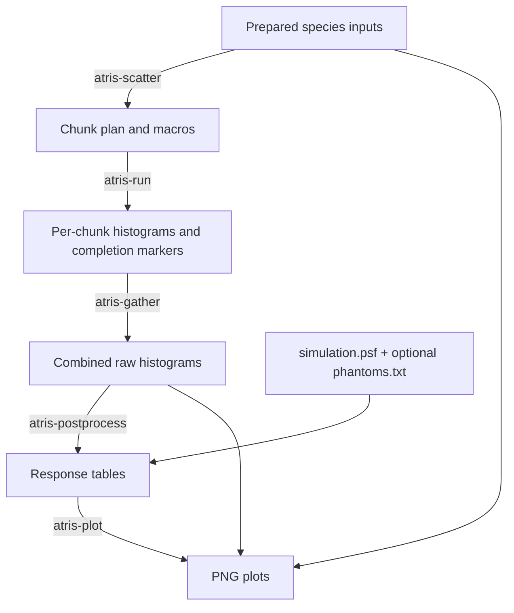

# Run and inspect the Earth simulation

**Previous step:** [Prepare an Earth atmosphere simulation](earth-nrlmsis-full.md).

**Next step:** [Apply a cosmic-ray spectrum](earth-spectrum-folding.ipynb).

Continue inside the `earth-nrlmsis-full` run directory from the preparation
tutorial. We will run one batch of protons and one batch of alphas. Each batch
is called a **chunk** and contributes to the same calculation. We will combine
their results and inspect the plots before running more. This example uses a
local terminal; the [execution guides](../running-atris/run-simulation.md) cover
other machines.

## From inputs to results



## 1. Plan and run chunks

Divide the requested particle counts into chunks, each with its own random seeds:

```bash
atris-scatter . --chunks 3000 --random-seed 12345
```

| Command | Reads | Creates |
| --- | --- | --- |
| `atris-scatter` | `protons.mac`, `alphas.mac` | `protons.chunk.mac`, `alphas.chunk.mac`, `chunks.txt`, empty `chunks/` |

Ordinary macros remain unchanged. Each species has 3000 chunks: 202 proton
events per chunk and 134 alpha events per chunk. The chunk macros contain these
per-chunk counts; `chunks.txt` supplies the seed pairs.

These small chunks give us the first results without completing the entire plan.
Runtime still depends on the sampled particles and the machine. For longer
runs, use the measured runtime to assess
[the chunk-size tradeoff](../running-atris/plan-chunks.md#choose-a-practical-chunk-size).

Run the first proton chunk and the first alpha chunk:

```bash
export G4FORCENUMBEROFTHREADS=4
atris-run . --entry 1 --physics-list FTFP_BERT_HP --mode response
atris-run . --entry 3001 --physics-list FTFP_BERT_HP --mode response
```

`--entry` selects one line of `chunks.txt`, numbered from one. In this plan,
lines 1–3000 are protons and lines 3001–6000 are alphas. Each command exits after
its selected chunk; the rest of the plan stays pending. Four threads are an
example setting; choose a count suitable for the machine.

| Reads | Creates |
| --- | --- |
| `chunks.txt`, species `.gdml`/`.bins`/`.chunk.mac`, optional `phantoms.txt` and numbered tables | Per-chunk raw histograms, a log, and a completion marker under `chunks/` |

A chunk's files have names like these; the seed numbers are illustrative:

```text
chunks/protons_123456_654321_h1_h1.1.csv
chunks/protons_123456_654321_h2_h2.ion.csv
chunks/protons_123456_654321_h2_h2.edep.csv
...other histogram files for that chunk...
chunks/protons_123456_654321.log
chunks/protons_123456_654321.COMPLETE
```

The marker records successful completion. A later `atris-run` skips marked
entries and reruns incomplete ones.

## 2. Gather completed chunks

As soon as a chunk finishes, combine the available completed histograms.
You can do this in another terminal in the run directory while the remaining
chunks continue running:

```bash
atris-gather .
```

| Reads | Creates or updates |
| --- | --- |
| Plan, completion markers, completed chunk histograms, `simulation.psf` | Summed histograms in the run directory |
| The same completed subset | `protons.gathered-chunks.txt`, `alphas.gathered-chunks.txt`, and species `.convergence.csv` files |

For this response-mode run, gather writes summed species CSV histograms and
records the included chunks in `.gathered-chunks.txt`. Convergence CSVs appear
once at least two chunks of a species have completed; this first inspection has
only one per species. Original chunk files remain, and unfinished chunks are ignored.

## 3. Process response tables and plots

First normalize the numerical results:

```bash
atris-postprocess .
```

| Reads | Creates |
| --- | --- |
| Raw proton and alpha CSV or ROOT histograms, `simulation.psf` | `.ioni` and `.edep` for each species |
| Optional raw phantom histograms and `phantoms.txt` | `.doseN`, `.equiN`, `.ratesN` for each selected phantom and species |

The PSF supplies layer volumes and interface areas; `phantoms.txt` supplies
phantom masses and areas. The post-processor also checks available `.bins`
and `.mac` inputs for consistency.

For example, `protons.ioni` and `protons.edep` contain an ID column, an altitude
column, and one response column per primary-energy bin. They describe ionizing
and total energy deposited per volume per simulated primary. The phantom
results also account for the phantom's mass and area. To obtain rates per
second, we will combine these responses with an incoming particle spectrum in
the next tutorial.

With only the first chunk of each species complete, some energy bins may be
unsampled and normalized values may be undefined. Run more chunks and assess
convergence before using the results for analysis.
The [normalization reference](../reference/outputs.md#processed-response-tables)
gives the precise formulas and units.

Then draw the results:

```bash
atris-plot .
```

| Reads | Creates |
| --- | --- |
| Prepared species inputs | Species input PNGs |
| Optional staged phantom tables and metadata | Phantom input PNGs |
| Processed response tables, raw diagnostic histograms, species geometry and energy axes | Species result PNGs, plus one result PNG per selected phantom/species |

The species PNGs are available without phantoms; the phantom PNGs appear
when the selection was staged during preparation:

```text
protons.inputs.png                       # source and atmosphere inputs
phantom.cell_zero_0.000MeV.inputs.png
phantom.icru_zero_0.000MeV_detAB_old.inputs.png
protons.png                              # source diagnostics and ionization
protons.cell_zero_0.000MeV.png             # phantom 0 responses
protons.icru_zero_0.000MeV_detAB_old.png    # phantom 1 responses
```

There are corresponding alpha plots. The cell counting panel uses the
all-ones placeholder described in [phantom preparation](earth-nrlmsis-full.md#prepare-the-phantom-inputs);
it is not a calculated counting efficiency. The numerical results remain in the
response tables and raw histograms. `atris-plot` reads these files to draw the
figures; it can also plot prepared inputs before any chunks run.

```{figure} ../images/earth-example/protons.png
:name: earth-proton-results
:alt: Proton ionization response versus altitude and primary energy, with primary-energy counts and source-position and direction diagnostics below.
:width: 100%

Proton results from the Earth example after accumulating chunks. Each energy
column in the upper panel shows the ionizing-deposition response with altitude,
before applying an incident spectrum. The angular diagnostics in this snapshot
omit one hemisphere.
```

[Open the full-size proton results](../images/earth-example/protons.png).

## Decide whether to continue

Use the [inspection checklist](../running-atris/process-results.md#decide-whether-to-continue)
to assess the first plots and logs. The comparison below shows how the same
Earth atmosphere's proton response develops with more sampling.

```{figure} ../images/earth-example/protons-4-40-400-chunks.png
:name: earth-chunk-comparison
:alt: Proton ionizing-deposition histograms after 4, 40, and 400 chunks, with a shared logarithmic colour scale and a thin red dashed estimate of the vertical proton stopping altitude.
:width: 100%

The Earth atmosphere after 4, 40, and 400 proton chunks, containing
6,052, 60,520, and 605,200 incoming protons. This comparison uses a run with
1,513 protons per chunk, compared with 202 in this tutorial. Each panel is
normalized per incoming proton and uses the same logarithmic colour scale.
The broad pattern appears early; more simulated particles reduce the noise
and fill sparsely sampled regions.
White cells contain no scored deposition. Similar colours on this scale can
still hide differences in statistical uncertainty.
The thin red dashed curve estimates the stopping altitude of vertically incoming
protons; it closely follows the sharp low-energy edge.
```

[Open the full-size chunk comparison](../images/earth-example/protons-4-40-400-chunks.png).
The [stopping-altitude calculation](../background/planetary-geometry.md#estimate-the-primary-stopping-altitude)
combines tabulated proton ranges with the PSF's density profile.
See [normalization and uncertainty](../background/normalization-and-uncertainty.md#what-the-uncertainty-measures-mean)
for interpreting the convergence diagnostics.

Use the first results to decide whether to revise the setup or continue.
If the setup looks right, process all remaining entries using the same inputs
and settings:

```bash
atris-run . --physics-list FTFP_BERT_HP --mode response
```

The two completed chunks are skipped. To sample a few more first, select
`--entry 2` and `--entry 3002` instead. Repeat gathering, post-processing, and
plotting to update the results. Use `atris-run . --check-complete` when you want
to verify that the entire plan has finished.

## Keep the inputs and results

Keep the PSF, species inputs, phantom files, chunk plan, chunk macros, outputs,
and completion markers together. They let you resume, extend, or rebuild the
results. Processed tables and PNGs can be regenerated from these files. For
revisions to the physical setup, see [how earlier outputs are affected](../running-atris/process-results.md#decide-whether-to-continue).

For particle-by-particle records beyond this tutorial's response histograms,
see [output modes](../reference/executable.md#output-modes).

The next tutorial is a Jupyter notebook at
`docs/tutorials/earth-spectrum-folding.ipynb`.
[View notebook](earth-spectrum-folding.ipynb) or download
{download}`earth-spectrum-folding.ipynb <earth-spectrum-folding.ipynb>`.

**Previous step:** [Prepare an Earth atmosphere simulation](earth-nrlmsis-full.md).

**Next step:** [Apply a cosmic-ray spectrum](earth-spectrum-folding.ipynb).
